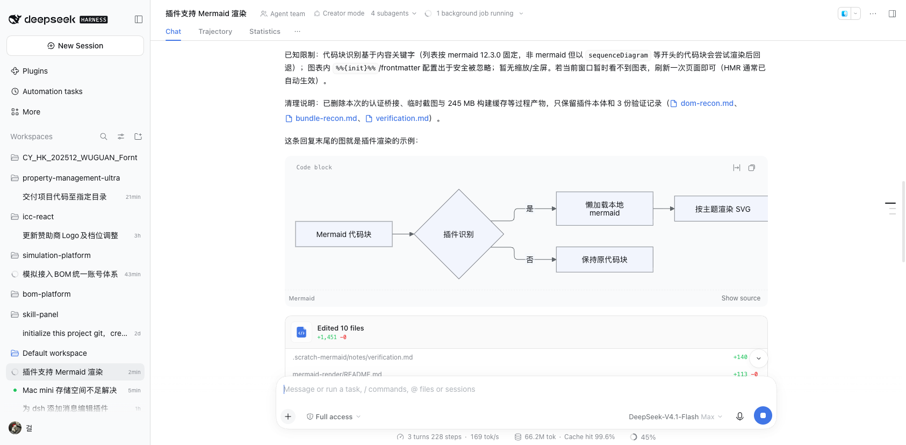
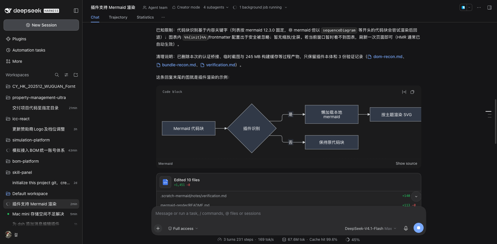
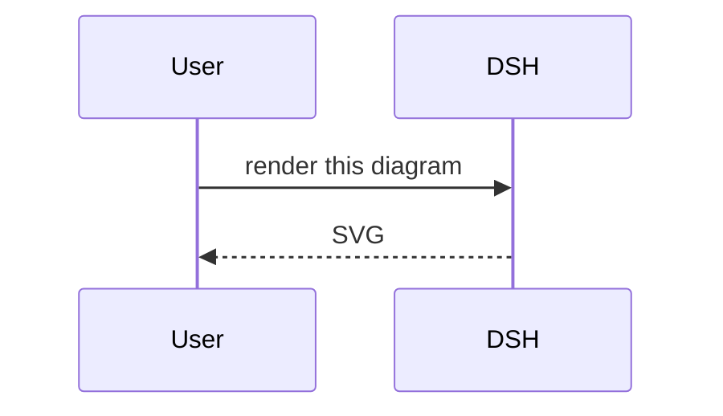

# dsh-mermaid-render

Mermaid diagram rendering for the [DeepSeek Harness](https://github.com/deepseek-ai/deepseek-harness)
Web UI. Fenced ` ```mermaid ` code blocks in chat replies, plan documents and every other
Markdown surface are rendered as inline SVG diagrams instead of plain code.


- Diagrams replace the code block visually; the original source stays available behind a
  **Show source / Show diagram** toggle, and the shipped header (language label, wrap, copy) is kept.
- Colors come from the active DSH theme (`--dsw-alias-*` tokens); every diagram re-renders on
  light/dark changes.
- Invalid or oversized diagrams fall back to the untouched code block with a localized inline note.
- Render only starts after a streaming message settles, so partial fences never flash diagrams.
- Disabling the plugin restores the original DOM exactly.
- Fully offline: mermaid is bundled and fetched lazily from the plugin package; nothing is loaded
  from a CDN at render time.

## Screenshot

A Mermaid fence in a chat reply, rendered inline by the plugin. The shipped code-card header
("Code block", wrap, copy) is preserved and the **Show source** toggle remains available:



<details>
<summary>Dark theme</summary>

The same message after switching the host theme. Diagram colors are re-resolved from the active
`--dsw-alias-*` tokens and the SVG is re-rendered automatically:



</details>

## Requirements

- DSH **0.2.2-rc.1** (tested). DSH plugin APIs are in preview and may change between releases.
- The DSH Web client (the desktop app and `dsh web` serve the same frontend).
- Node.js only for rebuilding from source; installing the plugin does not need a build step
  because the generated runtime files are committed.

## Installation

1. Clone this repository somewhere permanent — DSH links the plugin directory, so the clone must
   stay in place after installation:

   ```sh
   git clone https://github.com/nangongwentian-fe/dsh-mermaid-render.git
   ```

2. Install it into your DSH profile in one of these ways:

   - **Plugin Manager:** open **Plugins → Add plugin**, paste the absolute path of the cloned
     directory (the dialog accepts a local directory path) and confirm.
   - **Through the agent:** ask your DSH agent to install the local plugin bundle at that path
     (this calls the `plugin_manager` `install_bundle` action on the directory).

   Installation adds a `link:` dependency plus the bundle layer to the active profile, and the
   plugin activates immediately (a page reload is only needed if HMR did not pick it up).

3. Confirm the plugin in **Settings → Plugins → Installed plugins**: the row **Mermaid diagrams**
   should appear with its icon and an enabled switch. Toggle the switch to disable it; remove the
   bundle from the same page to uninstall.

## Usage

Send or view a message/document containing a Mermaid fence, for example:

````markdown

````

Supported diagram types are the ones registered by the pinned mermaid build (flowchart, sequence,
class, state, ER, gantt, pie, journey, git graph, mindmap, timeline, quadrant, sankey, xy chart,
block, packet, architecture, kanban, radar, treemap, C4, requirement, and the extra v12 diagram
families). See **Known limits** for detection details.

## How it works

The plugin is a browser-only DSH bundle; the Host half (`index.js`) is inert.

DSH's Markdown renderer owns code fences through `MarkdownText`/`CodeBlock` and exposes no
renderer registration point, so the plugin enhances the code-block DOM that renderer produced
(`.md-code-block` with `[data-code-block-banner]` and `[data-code-block-content]` children). It
appends its own sibling view and never re-renders React-owned children, which keeps streaming
updates and React reconciliation intact.

The mermaid library is not part of the boot bundle. A pinned, self-contained IIFE
(`vendor/mermaid.iife.min.js`) is wrapped into the package-local lazy chunk
`client.mermaid.js` and fetched through `require.async('./client.mermaid.js')` the first time a
diagram appears, so app startup only loads the small `client.js`. The chunk is served by the DSH
host from the plugin package itself.

## Security

Diagram source is untrusted model output. Rendering uses:

- `securityLevel: 'strict'`, `htmlLabels: false`, `suppressErrorRendering: true`;
- an extended mermaid `secure` config list covering `themeCSS`, `htmlLabels`, `themeVariables`,
  `theme`, `fontFamily`, `layout`, `look` and `darkMode`;
- stripping of every `%%{init …}%%` configuration directive (anywhere in the text) and a leading
  YAML front-matter block before rendering;
- a 50,000-character render limit.

This closes the config-directive escape in mermaid (an untrusted diagram could otherwise override
`themeCSS` and inject CSS or trigger external fetches even under `strict`). The displayed and copied
source keeps the authored text unchanged. See `docs/verification.md` for the verification record.

## Known limits

- **Detection is content-based**, because the shipped code card shows the generic "Code block" label
  for languages without a highlighter grammar. A fence whose first diagram line is a Mermaid diagram
  type keyword is enhanced; a non-Mermaid fence that begins with one of those keywords would be
  rendered as a diagram and then fall back to source. The keyword list is pinned to the mermaid
  12.3.0 build.
- **In-diagram configuration is ignored**: `%%{init}%%` directives and YAML front matter are stripped
  for security, so diagrams always use the host palette and default layout options.
- **Natural size**: diagrams render at their intrinsic size and scroll horizontally when wider than
  the message; there is no zoom/pan or full-screen view yet.
- **DOM contract**: the enhancer targets the shipped code-block DOM. If a future DSH release changes
  those selectors, the plugin degrades to plain code blocks rather than breaking the page.
- **Residual module state**: disabling the plugin removes its DOM, styles, observers and listeners,
  but the loaded chunk and its `globalThis.__MERMAID__` export stay in the page's module cache until
  the page reloads (they are inert).
- Pie-chart accents are a fixed hue set softened toward the host surface; they adapt to light/dark
  but are not host-brand colors.

## Build from source

The runtime files are committed; rebuilding is only needed when changing the enhancer or upgrading
mermaid.

```sh
node scripts/build-client.mjs
```

This copies `src/client.js` to `client.js` and regenerates `client.mermaid.js` from
`vendor/mermaid.iife.min.js`. CI verifies that the committed generated files match the sources.

To rebuild the pinned mermaid IIFE (for upgrades):

```sh
mkdir -p /tmp/dsh-mermaid-build && cd /tmp/dsh-mermaid-build
npm init -y
npm i mermaid@12.3.0 esbuild@0.28.2
printf "import mermaid from 'mermaid';\nglobalThis.__MERMAID__ = mermaid;\n" > entry-iife.js
./node_modules/.bin/esbuild entry-iife.js \
  --bundle --format=iife --minify --target=es2022 --platform=browser \
  --legal-comments=none --charset=utf8 --outfile=mermaid.iife.min.js
cp mermaid.iife.min.js <repo>/vendor/mermaid.iife.min.js
```

The committed `vendor/mermaid.iife.min.js` is the exact build that was tested. Rebuilding may
produce an equivalent but not byte-identical artifact when mermaid's transitive dependency ranges
resolve to newer patch releases; check the size and re-run the verification before releasing.

## Repository layout

| Path | Role |
| --- | --- |
| `index.js` | Inert Host plugin row (`export function apply() {}`). |
| `cordis.patch.yml` | Bundle layer that inserts the `mermaid-render` Loader row. |
| `src/client.js` | Authored browser enhancer (plain classic script). |
| `client.js` | Built copy of `src/client.js` (the package `./client`). |
| `vendor/mermaid.iife.min.js` | Pinned mermaid 12.3.0 build (build input). |
| `vendor/mermaid.LICENSE` | Upstream mermaid license. |
| `client.mermaid.js` | Generated lazy chunk containing the mermaid library. |
| `scripts/build-client.mjs` | Regenerates `client.js` and `client.mermaid.js`. |
| `locale/*.json` | Plugin Manager title/description (UI labels live inline in `src/client.js`). |
| `icon.svg` | Original plugin artwork. |
| `docs/verification.md` | Verification record for the released build. |
| `.github/workflows/ci.yml` | Build-consistency and vendor-purity checks. |

## License

Plugin code: **MIT** — see [LICENSE](LICENSE).

The bundled mermaid build remains under its own MIT license, and its bundle inlines 58 additional
npm packages under their respective licenses (including dual-licensed `elkjs`, EPL-2.0 OR
GPL-3.0-or-later). See [THIRD-PARTY-NOTICES.md](THIRD-PARTY-NOTICES.md).

## 中文简介

DeepSeek Harness Web 界面的 Mermaid 图表渲染插件：聊天回复、计划/文档等所有 Markdown 代码块中的
` ```mermaid ` 会被渲染成图表，保留源码切换、跟随浅色/深色主题，无效图表回退为代码块。mermaid
12.3.0 以懒加载分块随插件本地打包，渲染时不联网。安装：克隆本仓库后，在 DSH 的 **Plugins →
Add plugin** 中填入该目录的绝对路径（或让 DSH Agent 用 `plugin_manager install_bundle` 安装），
随后在 **Settings → Plugins** 中确认 "Mermaid diagrams" 已启用。插件代码采用 MIT 许可。
